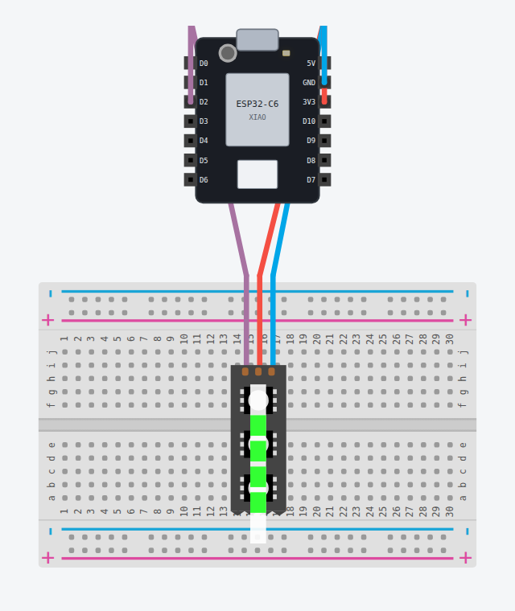

# XIAO ESP32-C6 NeoPixel Plugin End-to-End Test

Minimal MakeCode blocks project driving a 4-LED WS2812B NeoPixel strip on `pins.D2` (`GPIO2`) using the `light` plugin module.



## Run

```bash
node tests/e2e-xiao-esp32c6-neopixel.js
```
